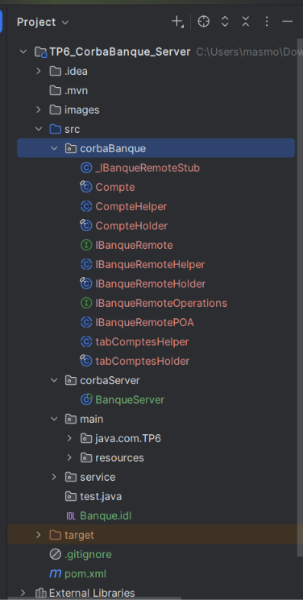
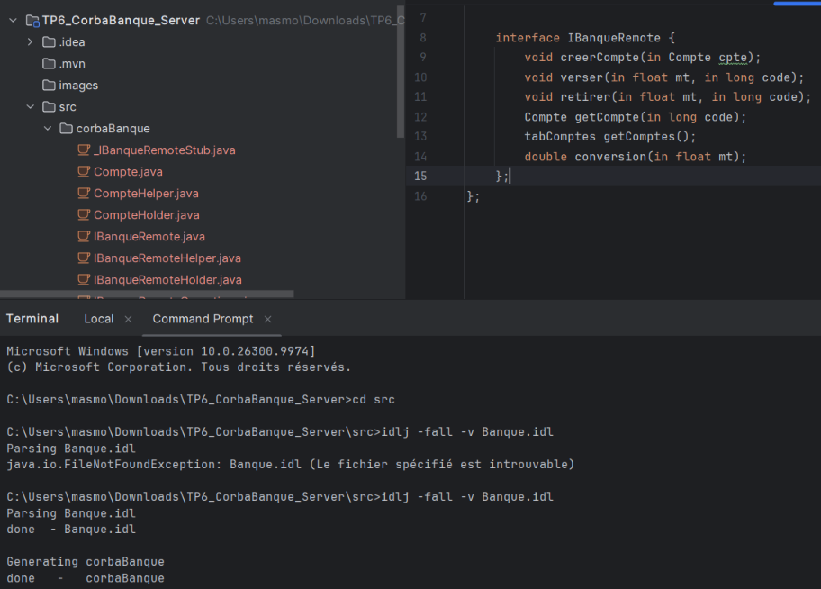
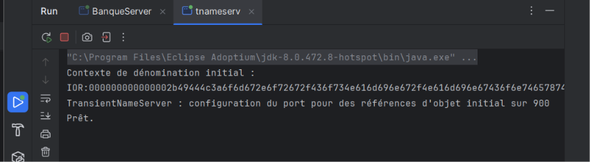
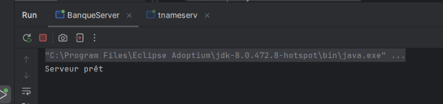

# TP 6 : Service Banque avec CORBA — Projet Serveur

**Projet :** `TP6_CorbaBanque_Server`

**Technologies :** Java 8 (JDK 8), CORBA, IDL (`idlj`), JNDI, `tnameserv`

## Rôle de `tnameserv`

`tnameserv` est le service de nommage transitoire de CORBA (fourni avec le JDK 8).
Il joue le rôle d'**annuaire** : le serveur y publie la référence de son objet distant
sous un nom (`BK`), et le client la retrouve grâce à ce nom (`lookup("BK")`) sans
connaître l'adresse du serveur. Il écoute sur le port 900. Il est dit « transitoire »
car ses enregistrements sont perdus à son arrêt : il doit être lancé **en premier**,
puis le serveur, puis le client.

---

## Objectif

Développer le côté **serveur** d'une application répartie CORBA : exposer l'objet distant `IBanqueRemote` (gestion de comptes bancaires) et le publier dans l'annuaire JNDI sous le nom `BK`.

## Structure du projet



---

## Étape 1 : Préparation de l'environnement

- Projet Maven IntelliJ `TP6_CorbaBanque_Server`.
- **JDK 8** : les classes `org.omg.*` et l'outil `idlj` n'existent plus dans les JDK récents.
- Dans `pom.xml` : `maven.compiler.source/target = 8` et `<sourceDirectory>src</sourceDirectory>`.

**Synthèse :** CORBA n'étant plus fourni après Java 8, le projet est configuré avec JDK 8, et Maven est réglé pour compiler directement le dossier `src`.

---

## Étape 2 : Interface IDL

Fichier `src/Banque.idl` :

```idl
module corbaBanque {
    struct Compte {
        long code;
        float solde;
    };
    typedef sequence<Compte> tabComptes;

    interface IBanqueRemote {
        void creerCompte(in Compte cpte);
        void verser(in float mt, in long code);
        void retirer(in float mt, in long code);
        Compte getCompte(in long code);
        tabComptes getComptes();
        double conversion(in float mt);
    };
};
```

On le compile depuis le dossier `src` :

```bat
idlj -fall -v Banque.idl
```




La génération a réussi. Le package `corbaBanque` contient le stub, le skeleton `IBanqueRemotePOA`, les Helper, Holder et Operations.

**Synthèse :** l'IDL décrit le contrat indépendamment du langage et `idlj` en génère le code technique (stub et skeleton).

---

## Étape 3 : Servant `service/BanqueImpl.java`

`BanqueImpl` hérite de `IBanqueRemotePOA` et implémente les six opérations :
- `creerCompte`, `verser`, `retirer`, `getCompte`, `getComptes` : gestion d'une liste de comptes en mémoire ;
- `conversion` : montant en euros multiplié par le taux de change en dinars (3,43).

**Synthèse :** le servant contient uniquement la logique métier ; la communication réseau est gérée par le code généré et l'ORB.

---

## Étape 4 : Serveur `corbaServer/BanqueServer.java`

1. Initialisation de l'ORB : `ORB.init(args, null)`
2. Récupération du `RootPOA` et activation du `POAManager`
3. Création du contexte JNDI : `new InitialContext()`
4. Création du servant : `new BanqueImpl()`
5. Publication : `ctx.rebind("BK", poa.servant_to_reference(od))`
6. Attente des clients : `orb.run()`

Fichier `jndi.properties` (placé dans `src/main/resources` pour être dans le classpath) :

```properties
java.naming.factory.initial=com.sun.jndi.cosnaming.CNCtxFactory
java.naming.provider.url=iiop://localhost:900
```

**Synthèse :** le serveur publie sa référence dans l'annuaire JNDI pour que les clients puissent la retrouver par son nom `BK`.

---

## Étape 5 : Exécution

Ordre obligatoire : **annuaire → serveur → client**.

### 5.1 Annuaire `tnameserv`

Configuration d'exécution IntelliJ :
- Main class : `com.sun.corba.se.impl.naming.cosnaming.TransientNameServer`
- Program arguments : `-ORBInitialPort 900`



### 5.2 Serveur



Le message « Serveur prêt » s'affiche et le processus reste actif. L'exécution du client est décrite dans le README du projet `TP6_CorbaBanque_Client`.

**Synthèse :** une fois l'annuaire démarré, le serveur enregistre son objet et reste à l'écoute des requêtes.

---

## Conclusion

Le serveur CORBA est opérationnel : l'interface est définie en IDL, le code est généré avec `idlj`, le servant est implémenté et l'objet distant est publié dans l'annuaire JNDI.